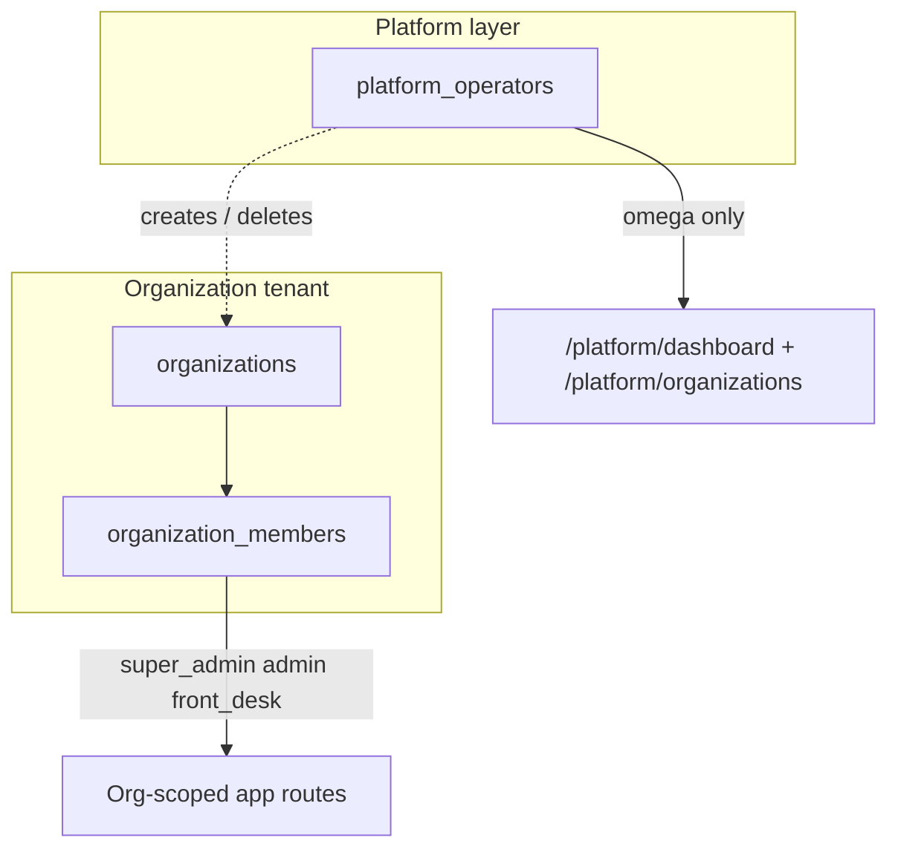
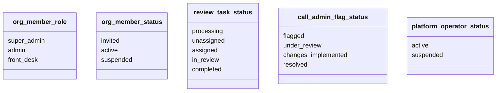
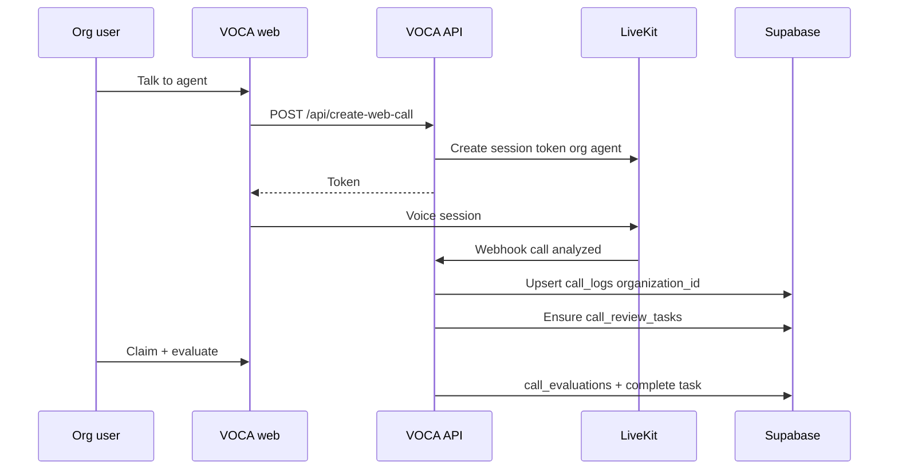
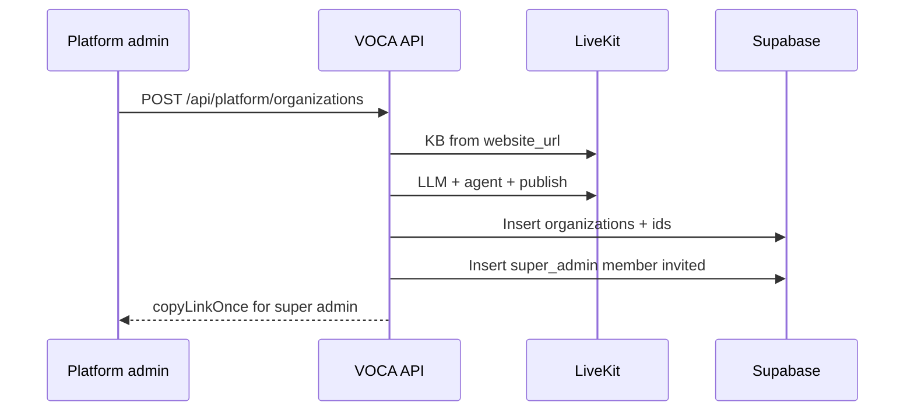

# VOCA Admin Portal — Product Handoff (LLM / Report Source)

**Purpose:** Structured reference for humans and LLMs drafting FYP reports, demos, architecture write-ups, and ops runbooks.  
**Product name (working):** VOCA  
**Document date:** November 2026  
**Classification:** Internal — **no** API keys, passwords, connection strings, or invite URLs in derivatives of this document.

---

## How to use this document (for LLMs)

1. Treat sections **1–2** as executive summary input; **3–5** as architecture; **6–8** as security and data model; **9–12** as product/UX; **13–14** as routes and glossary.
2. **Mermaid diagrams** are authoritative for relationships; **markdown tables** list columns and enums.
3. Voice vendor in product language is always **LiveKit** (web calls, agents, knowledge base, LLM versioning). Postgres may still store legacy column names `retell_*` on `organizations`; semantically they are **per-organization LiveKit resource IDs**.
4. Do not invent credentials, URLs, or tenant-specific IDs unless provided in a separate private appendix.
5. When generating reports, separate **platform (omega) admin** from **organization tenants** and **three org roles** (super_admin, admin, front_desk).

---

## 1. Executive summary

VOCA is a **multi-tenant admin portal** for university (and similar) **voice-agent programs**. Each **organization** (tenant) gets its own **LiveKit agent**, **knowledge base**, and **LLM configuration**, stored on the org record. Staff use one web app to:

- Run **browser voice sessions** (“Talk to agent”)
- Review **call logs** (recording, transcript, summary)
- Complete a **human review queue** with Likert evaluations and optional **admin flags**
- Manage **members** and **agent content** (knowledge base, system prompt)

A separate **platform admin (omega)** layer can create/delete organizations, view **cross-tenant usage and cost estimates**, and bootstrap the first platform operator. Organization users never see other tenants’ data.

**Auth:** Supabase Auth (email/password, invite-only). API access requires JWT + active **organization membership** (or active **platform operator** for `/api/platform/*`).

---

## 2. Goals and boundaries

| Goal | Product behavior |
|------|-------------------|
| Institutional branding | Org name in chrome; no third-party voice UI embedded for staff |
| Accountability | One review task per completed call; evaluations tied to `reviewer_member_id` |
| Quality | Five-point Likert rubric; optional flag → super admin workflow |
| Agent control | Admins edit KB + LLM prompt via portal (LiveKit draft/publish pattern) |
| Multi-tenancy | `organization_id` on calls and domain tables; per-org LiveKit IDs |
| Platform economics | Omega dashboard: calls, minutes, **$0.30/min** default cost estimate (configurable) |

**Out of scope (current):** Caller follow-up case management, KB change-request approval pipeline, Google OAuth, automated E2E suite, guaranteed Retell/LiveKit resource cleanup on org delete.

---

## 3. Technology stack

| Layer | Technology |
|-------|------------|
| Frontend | React 19, TypeScript, Vite, Tailwind CSS, React Router |
| UI | shadcn-style components |
| Charts | Recharts (7-day sparklines on KPI cards; intent card is text-only) |
| API (local) | Express (Node.js) |
| API (production) | Vercel serverless — single `/api/*` dispatcher |
| Database & auth | Supabase (Postgres, Auth, Storage for recordings) |
| Voice | **LiveKit** (web calls, agents, knowledge base APIs, agent/LLM versions) |
| Client voice | LiveKit browser SDK (web call from dashboard) |

**Environment variables (names only, never commit values):** `LIVEKIT_API_KEY`, per-org agent/KB IDs on `organizations`, `LIVEKIT_DEFAULT_VOICE_ID`, Supabase URL/keys/service role, `VOCA_APP_URL`, `VOCA_PLATFORM_BOOTSTRAP_SECRET`, `VOCA_PLATFORM_COST_PER_MINUTE`, `DATABASE_URL` (migrations).

---

## 4. Tenancy and roles

### 4.1 Role layers



| Actor | Table / signal | App surface |
|-------|----------------|-------------|
| **Platform admin** | `platform_operators.status = active` | `/platform/dashboard`, `/platform/organizations` |
| **Super admin** | `organization_members.role = super_admin` | Full org app + Activity + Flagged calls + member admin |
| **Admin** | `role = admin` | Dashboard, logs, KB, prompt, members (view), management stats |
| **Front desk** | `role = front_desk` | Dashboard, logs, review queue, evaluate, members (read-only) |

**Rules:**

- One email → **at most one** organization (`organization_members.email` globally unique).
- Platform operator email should **not** also be an org member if omega login is required (auth checks membership first).
- Inactive/suspended members → API **403** even with valid JWT.

### 4.2 Per-organization LiveKit resources

On create (platform flow), server provisions **KB (seed URL) → LLM → agent → publish** and stores on `organizations`:

| Logical field | Purpose |
|---------------|---------|
| `livekit_agent_id` | Webhooks + web calls resolve tenant |
| `livekit_knowledge_base_id` | KB admin API |
| `livekit_llm_id` | Prompt publish flow |
| `website_url` | Initial KB source URL |

Legacy Bahria org may have been backfilled from env; runtime uses org row with env fallback only when row is empty.

---

## 5. Authentication and invitations

- **Sign-in:** Email/password via Supabase; public sign-up disabled.
- **Activate:** Links Auth user to `organization_members` or `platform_operators`.
- **Org invites:** Super admin → pending member + Supabase invite link (`copyLinkOnce`).
- **Platform bootstrap:** One-time `POST /api/platform/bootstrap` with bootstrap secret (first operator only).
- **API:** `Authorization: Bearer <access_token>`; server loads member or platform operator.

---

## 6. Data model — entity relationship

```mermaid
erDiagram
  organizations ||--o{ organization_members : has
  organizations ||--o{ organization_invitations : has
  organizations ||--o{ activity_logs : has
  organizations ||--o{ call_logs : scopes
  organizations ||--o{ call_review_tasks : has
  organizations ||--o{ call_evaluations : has
  organizations ||--o{ call_evaluation_admin_flags : has

  organization_members ||--o{ call_evaluations : reviews
  organization_members ||--o{ call_review_tasks : assigned
  organization_members ||--o{ activity_logs : actor

  call_logs ||--|| call_review_tasks : "call_id"
  call_evaluations ||--o| call_evaluation_admin_flags : may_flag
  call_evaluation_admin_flags ||--o{ call_evaluation_admin_flag_history : history

  platform_operators {
    uuid id PK
    uuid auth_user_id FK
    text email
    text display_name
    platform_operator_status status
  }

  organizations {
    uuid id PK
    text slug UK
    text name
    text status
    text website_url
    text livekit_agent_id
    text livekit_knowledge_base_id
    text livekit_llm_id
  }

  organization_members {
    uuid id PK
    uuid organization_id FK
    uuid auth_user_id FK
    text email UK_global
    org_member_role role
    org_member_status status
  }

  call_logs {
    text id PK
    uuid organization_id FK
    text name phone email enrollment intent
    int duration_seconds
    timestamptz started_at
    jsonb transcript
    text audio_url
  }
```

*`livekit_*` columns may appear as `retell_*` in migration SQL; meaning is LiveKit resource ID.*

---

## 7. Data model — tables and columns

### 7.1 `organizations`

| Column | Type | Notes |
|--------|------|--------|
| `id` | uuid PK | |
| `slug` | text unique | URL-safe tenant key |
| `name` | text | Display name |
| `status` | text | e.g. `active` |
| `website_url` | text nullable | KB seed URL (new tenants) |
| `livekit_agent_id` | text nullable | `retell_agent_id` in DB |
| `livekit_knowledge_base_id` | text nullable | |
| `livekit_llm_id` | text nullable | |
| `created_at`, `updated_at` | timestamptz | |

### 7.2 `organization_members`

| Column | Type | Notes |
|--------|------|--------|
| `id` | uuid PK | |
| `organization_id` | uuid FK → organizations | |
| `auth_user_id` | uuid FK → auth.users nullable | Set on first login |
| `email` | text | Globally unique (one org per email) |
| `display_name` | text nullable | |
| `role` | enum | `super_admin`, `admin`, `front_desk` |
| `status` | enum | `invited`, `active`, `suspended` |
| `invited_at`, `joined_at` | timestamptz | |

### 7.3 `platform_operators`

| Column | Type | Notes |
|--------|------|--------|
| `id` | uuid PK | |
| `auth_user_id` | uuid FK nullable | |
| `email` | text unique (lower) | |
| `display_name` | text nullable | |
| `status` | enum | `active`, `suspended` |

### 7.4 `organization_invitations`

| Column | Type | Notes |
|--------|------|--------|
| `id` | uuid PK | |
| `organization_id` | uuid FK | |
| `email` | text | Unique per org |
| `role` | org_member_role | |
| `status` | text | `pending`, `accepted`, `revoked`, `expired` |
| `invited_by_member_id` | uuid FK nullable | |
| `expires_at`, `accepted_at` | timestamptz | |

### 7.5 `call_logs`

| Column | Type | Notes |
|--------|------|--------|
| `id` | text PK | LiveKit call id |
| `organization_id` | uuid FK nullable | Set via webhook agent mapping |
| `name`, `phone`, `email`, `enrollment`, `intent` | text | Caller metadata / classification |
| `duration_seconds` | int | |
| `started_at` | timestamptz | |
| `summary` | text nullable | |
| `audio_url` | text nullable | Recording |
| `transcript` | jsonb | Utterances |
| `call_status` | text | e.g. completed / ongoing |
| `analyzed` | boolean | |
| `raw_payload` | jsonb nullable | Webhook archive |

### 7.6 `call_review_tasks`

| Column | Type | Notes |
|--------|------|--------|
| `id` | uuid PK | |
| `organization_id` | uuid FK | |
| `call_id` | text unique | One task per call |
| `status` | enum | `processing`, `unassigned`, `assigned`, `in_review`, `completed` |
| `assigned_member_id` | uuid FK nullable | |
| `claimed_at`, `completed_at` | timestamptz | |

### 7.7 `call_evaluations`

| Column | Type | Notes |
|--------|------|--------|
| `id` | uuid PK | |
| `organization_id` | uuid FK | |
| `call_id` | text | Unique per org with org |
| `reviewer_member_id` | uuid FK nullable | |
| `verdict` | enum nullable | Legacy: correct / partial / incorrect / unable |
| `rating_q1` … `rating_q5` | smallint 1–5 | Likert |
| `average_rating` | numeric | Mean of q1–q5 |
| `suggestions` | text nullable | |
| `flag_for_admin` | boolean | |
| `flag_priority` | text | `normal`, `urgent` |
| `flag_reason` | text nullable | |

### 7.8 `call_evaluation_admin_flags` and history

**`call_evaluation_admin_flags`**

| Column | Notes |
|--------|--------|
| `evaluation_id` | Unique — one flag row per evaluation |
| `call_id` | Denormalized for queries |
| `status` | `flagged`, `under_review`, `changes_implemented`, `resolved` |
| `admin_notes`, `changes_documented` | Super admin workflow |

**`call_evaluation_admin_flag_history`** — status transitions with `from_status`, `to_status`, actor, timestamps.

### 7.9 `activity_logs`

| Column | Notes |
|--------|--------|
| `organization_id` | |
| `actor_member_id` | Who performed action |
| `action`, `entity_type`, `entity_id` | Audit semantics |
| `metadata` | jsonb |

---

## 8. Enumerations (reference)



---

## 9. Permissions matrix (organization roles)

| Capability | Super admin | Admin | Front desk |
|------------|:-----------:|:-----:|:----------:|
| Dashboard KPIs + Talk to agent | ✓ | ✓ | ✓ |
| Management overview | ✓ | ✓ | — |
| Call logs | ✓ | ✓ | ✓ |
| Review queue / evaluate | — | — | ✓ |
| Members (invite/suspend) | ✓ | view | read-only |
| Knowledge base | ✓ | ✓ | — |
| Agent prompt publish | ✓ | ✓ | — |
| Activity | ✓ | — | — |
| Flagged calls | ✓ | — | — |

Platform admin: **only** platform routes and `/api/platform/*` (not org call logs unless impersonation is added later).

---

## 10. Core modules (product behavior)

### 10.1 Organization dashboard

- KPIs: total calls, avg minutes, total minutes (**all time**); sparkline **last 7 days** (Asia/Karachi buckets).
- Call intent card: counts by intent (text list, no chart).
- **Talk to agent:** web session via org’s `livekit_agent_id`.

### 10.2 Platform dashboard (omega)

- Filter: **all organizations** or one tenant.
- Same KPI pattern + **estimated cost** = total minutes × `VOCA_PLATFORM_COST_PER_MINUTE` (default 0.3 USD).
- Per-org breakdown table when filter = all.

### 10.3 Call sync and webhooks

LiveKit sends call events → API resolves **agent id → organization** → upserts `call_logs` → ensures `call_review_tasks` row.

### 10.4 Review queue and Likert evaluation

Claim is atomic; one evaluation per call per org; optional admin flag creates `call_evaluation_admin_flags`.

### 10.5 Knowledge base and agent prompt

- KB: uploads/URLs/sitemap ingest via server proxy to LiveKit.
- Prompt: draft agent version → update LLM → publish (cannot PATCH published in place).

---

## 11. Request flows (diagrams)

### 11.1 Web call and review



### 11.2 Platform creates tenant



---

## 12. Route map

| Route | Screen | Audience |
|-------|--------|----------|
| `/login` | Sign in | Public |
| `/accept-invite` | Set password from invite | Public |
| `/` | Org dashboard | Org members |
| `/call-logs` | Call logs | Org members |
| `/review-queue` | Review queue | Front desk |
| `/review-queue/:callId` | Review detail | Front desk |
| `/members` | Members | Org (varies by role) |
| `/activity` | Front desk activity | Super admin |
| `/flagged-calls` | Flags list | Super admin |
| `/flagged-calls/:flagId` | Flag detail | Super admin |
| `/knowledge-base` | KB | Super admin, admin |
| `/agent-prompt` | LLM prompt | Super admin, admin |
| `/platform/dashboard` | Cross-tenant usage | Platform admin |
| `/platform/organizations` | Create/delete orgs | Platform admin |

---

## 13. Security summary

| Topic | Approach |
|-------|----------|
| Org API | JWT + active `organization_members` |
| Platform API | JWT + active `platform_operators` |
| RLS | Enabled; app uses **service role** on server (no anon policies on org data) |
| Webhook | LiveKit → public route; verify signatures in hardening |
| Secrets | Server env only; invites `copyLinkOnce` |

---

## 14. Deployment and migrations (conceptual)

| Migration theme | File pattern (repo) |
|-----------------|---------------------|
| Organizations foundation | `20261115180000_organizations.sql` |
| Evaluations + invitations | `20261115190000_phase2_5_extensions.sql` |
| Review tasks | `20261115193000_call_review_tasks.sql` |
| Likert + admin flags | `20261115210000_evaluation_likert_flags.sql` |
| Platform multitenancy | `20261117160000_platform_multitenancy.sql` |
| Org website URL | `20261117170000_organization_website_url.sql` |

Scripts: `npm run db:migrate:platform`, `npm run db:migrate:org-website`, `npm run org:backfill-voice` (legacy id backfill).

---

## 15. Glossary

| Term | Definition |
|------|------------|
| VOCA | Voice operations / university admin portal |
| Omega / platform admin | `platform_operators`; manages tenants |
| Tenant / organization | Row in `organizations` |
| Talk to agent | Browser web call (formerly “Talk to Ali” in early UI) |
| LiveKit | Voice, agent, KB, and LLM platform (product terminology) |
| Review task | `call_review_tasks` — one human review per call |
| Admin flag | Escalation from evaluation to super admin |

---

## 16. Suggested report outlines (for LLMs)

**Executive:** §1, §2, §4.1  
**Technical / FYP architecture:** §3, §6–8, §11  
**Database chapter:** §6–8 (copy diagrams and tables)  
**User manual:** §9–10, §12  
**Multi-tenancy / SaaS angle:** §4, §10.2, §11.2  
**Limitations:** §2 (out of scope), §13  

---

## 17. Implementation note (for maintainers only)

The production codebase may still call LiveKit-equivalent HTTP APIs under legacy integration module names and `retell_*` DB columns. **Product and customer-facing documentation should say LiveKit.** Schema renames to `livekit_*` are optional follow-up migrations.

---

*End of product handoff document.*